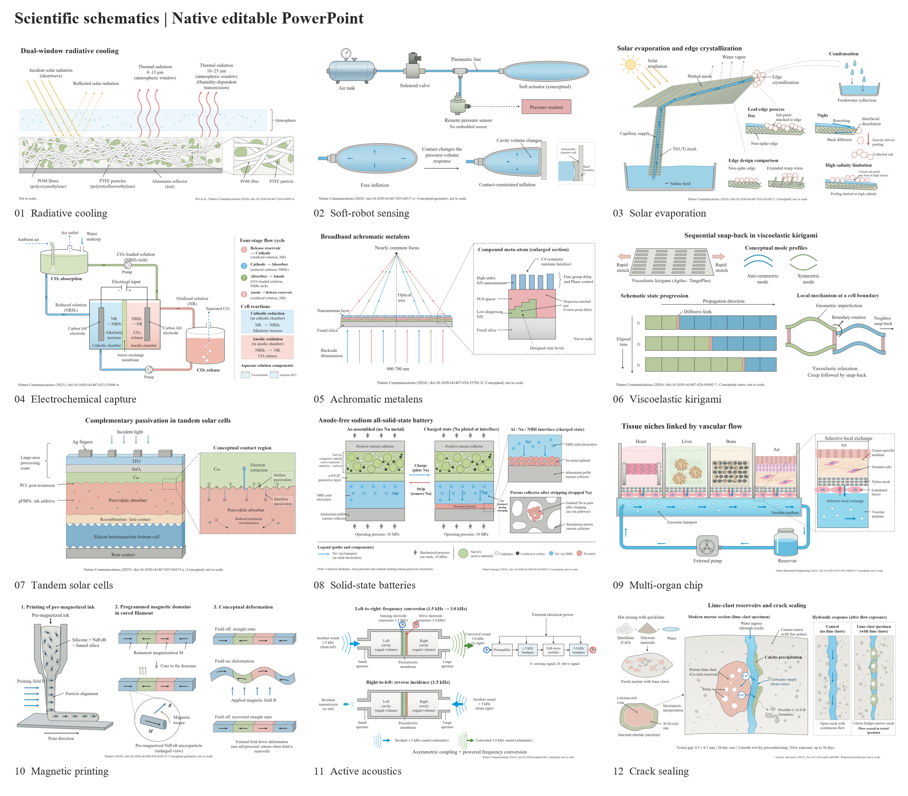
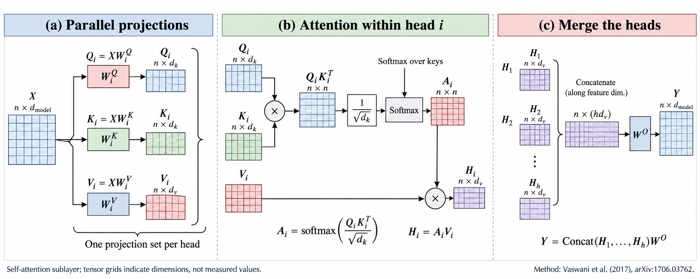

# Scientific Schematic to PPT

**From research materials to academic schematics you can edit element by element in PowerPoint.**

[中文](README.md) · [Skill](SKILL.md) · [Gallery](docs/gallery.en.md) · [Community](docs/community-gallery.en.md) · [Downloads](https://github.com/dxlian/Scientific-Schematic-to-PPT/releases/latest) · [Style guide](references/style-guide.md)

I built this skill to connect research reading, schematic design, and native PowerPoint construction. It interprets the scientific content, develops a complete design, and presents an image for review before rebuilding the approved figure element by element as a `.pptx`. You can then revise labels, rearrange structures, move components, and change colors directly in PowerPoint without regenerating the entire image for each local change.

The aim is simple: explain the science clearly and keep the figure practical to revise. **Simplify the visual language, not the scientific structure.**

## Native editable PowerPoint

Editability is part of the deliverable. Text, shapes, curves, and arrows become separate PowerPoint objects, with related components grouped by structure. Reconstruction preserves the approved layout and its explanatory detail.

| Figure element | What you can edit in PowerPoint |
| --- | --- |
| Text and labels | Wording, font, size, color, alignment, and position |
| Arrows and lines | Endpoint positions, direction, width, color, and dash style |
| Curves and irregular boundaries | Shape points, outlines, fills, and stacking order |
| Apparatus components and material regions | Individual selection, movement, resizing, duplication, and recoloring |
| Structural groups | Move related parts together, or ungroup, revise, and regroup them |
| Scene files | Retain element coordinates, styles, and hierarchy for programmatic revisions and rebuilding |

**Deliverables include a native `.pptx`, a preview rendered from the PPT, and the scene JSON used to build it.** All twelve showcase examples are available individually and as a combined presentation.

[Download the 12-figure PPT collection](examples/engineering-gallery.pptx) · [Explore individual editable examples](docs/gallery.en.md)

This is element-by-element reconstruction after review, not unconditional one-click image vectorization. Photographs and measured images retain their source pixels and have a clearly stated editing scope. Positioned lines may need manual adjustment after components move. The final render still needs inspection for text fit, connections, and layout.

## Examples

### Twelve engineering studies



I selected studies from Nature, Nature Energy, Nature Biomedical Engineering, Nature Communications and Science Advances, spanning thermal management, robotics, chemical engineering, optics, energy storage, bioengineering, acoustics and construction materials. Each composition answers a specific question rather than forcing every subject into one flowchart.

[Download the editable 12-figure collection](examples/engineering-gallery.pptx) · [Individual PPT files, scenes and paper sources](docs/gallery.en.md)

All twelve examples have been rebuilt element by element. The images shown here are actual PPT renders. Text, arrows, curves, material regions and apparatus components remain editable, and each example is also available as a separate presentation.

### Algorithm and information flow



An independently designed explanation of projections, attention within a head, and head aggregation. The tensor grids indicate structure, not measured values. This example is a design preview, not yet an editable presentation.

Method: [Vaswani et al., 2017, Attention Is All You Need](https://arxiv.org/abs/1706.03762). No source figure is reproduced.

## Share your work

I welcome academic schematics made with this skill. Submit a preview, a public link to the editable PPT, and a short description of its purpose and how you made it. After reviewing the source information, sharing permissions, and files, I will feature selected contributions in the community gallery with author credit.

[Submit a case](https://github.com/dxlian/Scientific-Schematic-to-PPT/issues/new?template=share-your-figure.yml) · [Community gallery and submission guide](docs/community-gallery.en.md)

Share only material you are entitled to make public. Community work retains its declared license; submission does not automatically place it under this repository's MIT license.

## Design principles

- White backgrounds, precise linework, restrained color, and clear hierarchy.
- Complete objects, connections, and explanatory local details.
- Subject-appropriate sections, apparatus drawings, paired states, architectures, or mechanisms.
- English labels and Times New Roman by default, sized for the intended placement.
- Native editable curves, components, and text rather than a flattened background.
- Explicit meanings for colors and arrows.

## Workflow

**Source material → Interpretation → Design → Preview → Approval → Editable PPT**

Start with instructions, papers, experimental protocols, or reference images. Establish the scientific question and relationships before composing the figure. Review and revise a raster preview, then explicitly approve that version before reconstruction.

Reconstruction follows the approved composition, geometry, connections, and detail. Compare the actual presentation render with the preview before delivery.

## Applications

Research backgrounds, experimental apparatus, methods, mechanisms, material structures, biological processes, computational architectures, and other academic schematics. Measured plots and scientific images retain their real sources; generated graphics do not replace experimental evidence.

## Installation

Download the compact archive with `-skill-` in its name from [Releases](https://github.com/dxlian/Scientific-Schematic-to-PPT/releases/latest). The full archive also includes the example presentations, scene files, and gallery images.

Extract it and place the `scientific-schematic-to-ppt` folder in your local skills directory:

```text
Windows: %USERPROFILE%\.codex\skills\scientific-schematic-to-ppt
macOS/Linux: ~/.codex/skills/scientific-schematic-to-ppt
```

If `CODEX_HOME` is set, use its `skills` directory. The entry point should be `skills/scientific-schematic-to-ppt/SKILL.md`. Reopen the session after installation.

Alternatively, clone the full repository and place its folder in that directory:

```bash
git clone https://github.com/dxlian/Scientific-Schematic-to-PPT.git scientific-schematic-to-ppt
```

## Usage

```text
Use $scientific-schematic-to-ppt to read the attached paper.
Design an academic schematic showing the system, its key components,
and the mechanism. Keep the styling restrained and the content complete.
Use English labels and Times New Roman.
Show a raster preview first; rebuild it as native editable PPT after I approve it.
```

Specify figure width, journal requirements, language, or palette when needed. Reference images can guide visual style without copying their composition.

## Requirements

An assistant with file-reading and image-generation capabilities, plus Python 3.10+. Native PPT construction uses the standard library. PDF extraction and visual comparisons use optional dependencies:

```bash
python -m pip install -r requirements-optional.txt
```

Inspect the final presentation through PowerPoint, WPS, or another available renderer. Photographs and measured images remain raster elements with a different editing scope.

## License

Code, original documentation, and original examples are provided under the [MIT License](LICENSE). External papers, images, fonts, and tools retain their own licenses. Optional dependencies PyMuPDF and Pillow, and presentation applications, are not bundled. The examples explain published scientific work; they are not official figures or endorsements from the paper authors or journals.
