# Engineering Gallery

I selected twelve studies across engineering disciplines and designed original schematics around their structures and mechanisms. The figures share typography, linework and a restrained palette while using subject-specific compositions.

All twelve examples include **native editable PowerPoint files** and scene files. The images below are actual PPT renders. Text, curves, arrows and components can be edited individually or within their groups. Conceptual geometry and symbol counts do not represent measured data.

[Download the twelve-figure PPT collection](../examples/engineering-gallery.pptx)

## 01 · Radiative cooling

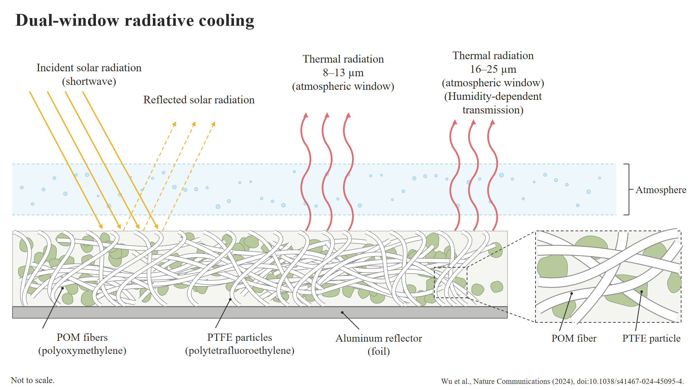

[Editable PPT](../examples/cases/01-radiative-cooling.pptx) · [Scene file](../examples/cases/01-radiative-cooling.json)

Source: [A dual-selective thermal emitter with enhanced subambient radiative cooling performance.](https://doi.org/10.1038/s41467-024-45095-4), *Nature Communications* (2024). Independently composed from the reported concepts; no published figure is reproduced.

## 02 · Soft-robot sensing

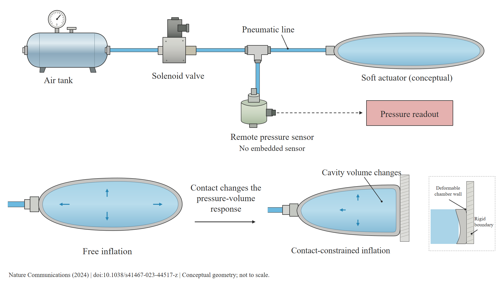

[Editable PPT](../examples/cases/02-fluidic-sensing.pptx) · [Scene file](../examples/cases/02-fluidic-sensing.json)

Source: [A retrofit sensing strategy for soft fluidic robots.](https://doi.org/10.1038/s41467-023-44517-z), *Nature Communications* (2024). Independently composed from the reported concepts; no published figure is reproduced.

## 03 · Solar evaporation

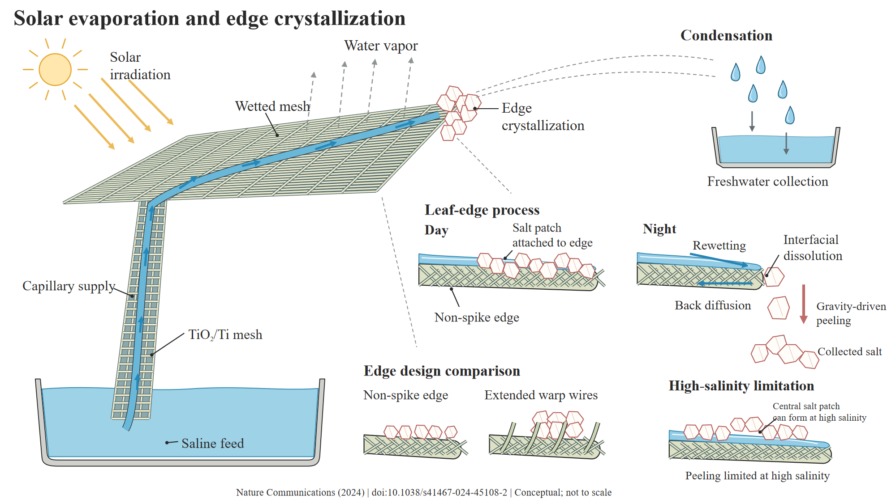

[Editable PPT](../examples/cases/03-solar-distillation.pptx) · [Scene file](../examples/cases/03-solar-distillation.json)

Source: [Sustainable biomimetic solar distillation with edge crystallization for passive salt collection and zero brine discharge](https://doi.org/10.1038/s41467-024-45108-2), *Nature Communications* (2024). Independently composed from the reported concepts; no published figure is reproduced.

## 04 · Electrochemical capture

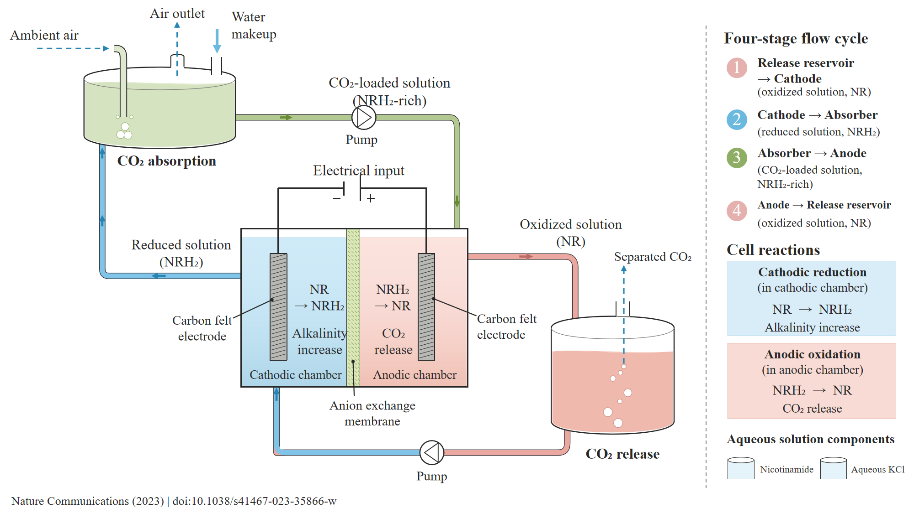

[Editable PPT](../examples/cases/04-carbon-capture.pptx) · [Scene file](../examples/cases/04-carbon-capture.json)

Source: [Electrochemical direct air capture of CO2 using neutral red as reversible redox-active material](https://doi.org/10.1038/s41467-023-35866-w), *Nature Communications* (2023). Independently composed from the reported concepts; no published figure is reproduced.

## 05 · Achromatic metalens

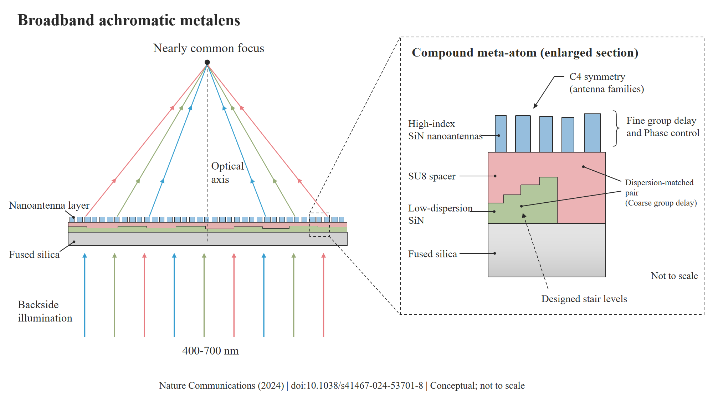

[Editable PPT](../examples/cases/05-achromatic-metalens.pptx) · [Scene file](../examples/cases/05-achromatic-metalens.json)

Source: [Achromatic metalenses for full visible spectrum with extended group delay control via dispersion-matched layers](https://doi.org/10.1038/s41467-024-53701-8), *Nature Communications* (2024). Independently composed from the reported concepts; no published figure is reproduced.

## 06 · Viscoelastic kirigami

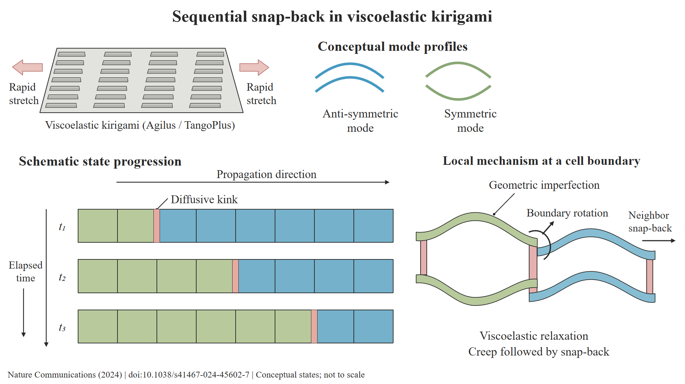

[Editable PPT](../examples/cases/06-kirigami.pptx) · [Scene file](../examples/cases/06-kirigami.json)

Source: [Diffusive kinks turn kirigami into machines](https://doi.org/10.1038/s41467-024-45602-7), *Nature Communications* (2024). Independently composed from the reported concepts; no published figure is reproduced.

## 07 · Tandem solar cells

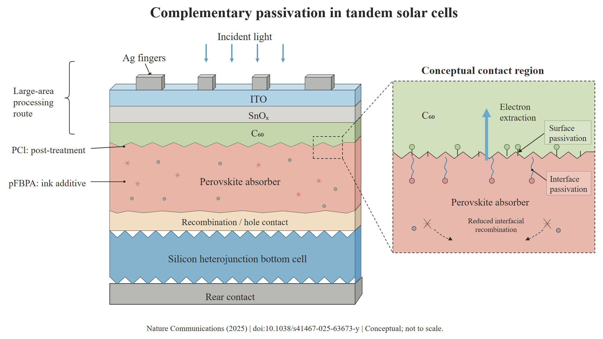

[Editable PPT](../examples/cases/07-tandem-solar.pptx) · [Scene file](../examples/cases/07-tandem-solar.json)

Source: [60 cm2 perovskite-silicon tandem solar cells with an efficiency of 28.9% by homogeneous passivation](https://doi.org/10.1038/s41467-025-63673-y), *Nature Communications* (2025). Independently composed from the reported concepts; no published figure is reproduced.

## 08 · Solid-state batteries

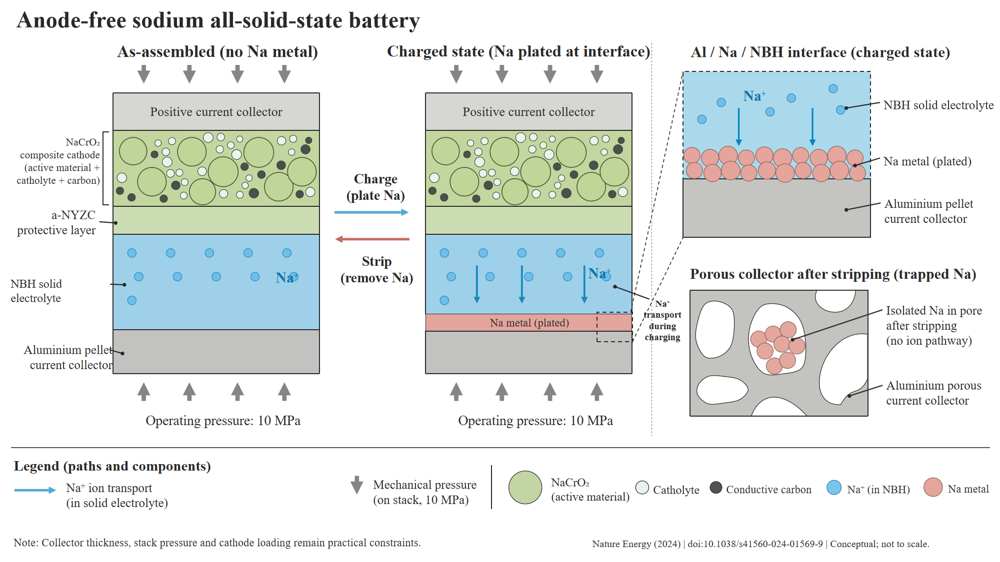

[Editable PPT](../examples/cases/08-solid-state-battery.pptx) · [Scene file](../examples/cases/08-solid-state-battery.json)

Source: [Design principles for enabling an anode-free sodium all-solid-state battery](https://doi.org/10.1038/s41560-024-01569-9), *Nature Energy* (2024). Independently composed from the reported concepts; no published figure is reproduced.

## 09 · Multi-organ chip

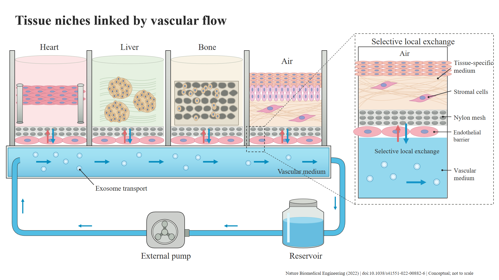

[Editable PPT](../examples/cases/09-multi-organ-chip.pptx) · [Scene file](../examples/cases/09-multi-organ-chip.json)

Source: [A multi-organ chip with matured tissue niches linked by vascular flow](https://doi.org/10.1038/s41551-022-00882-6), *Nature Biomedical Engineering* (2022). Independently composed from the reported concepts; no published figure is reproduced.

## 10 · Magnetic printing

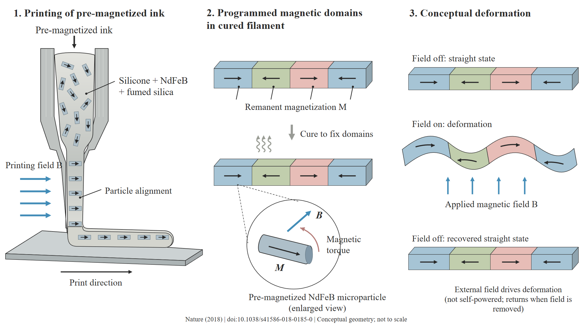

[Editable PPT](../examples/cases/10-magnetic-printing.pptx) · [Scene file](../examples/cases/10-magnetic-printing.json)

Source: [Printing ferromagnetic domains for untethered fast-transforming soft materials](https://doi.org/10.1038/s41586-018-0185-0), *Nature* (2018). Independently composed from the reported concepts; no published figure is reproduced.

## 11 · Active acoustics

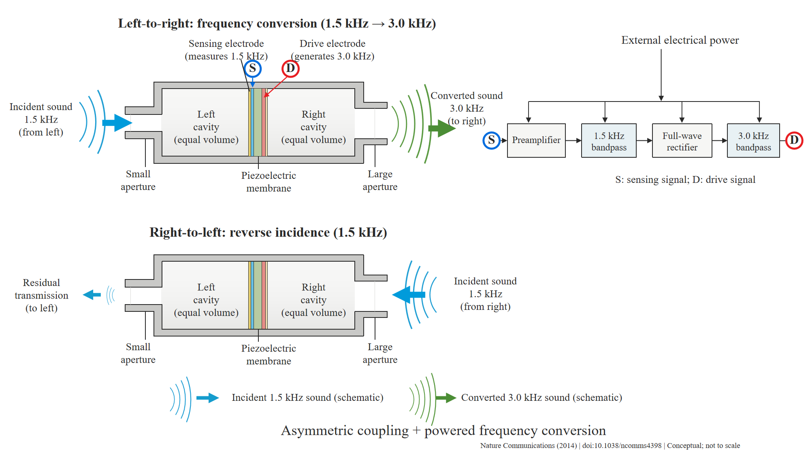

[Editable PPT](../examples/cases/11-active-acoustics.pptx) · [Scene file](../examples/cases/11-active-acoustics.json)

Source: [Non-reciprocal and highly nonlinear active acoustic metamaterials](https://doi.org/10.1038/ncomms4398), *Nature Communications* (2014). Independently composed from the reported concepts; no published figure is reproduced.

## 12 · Crack sealing

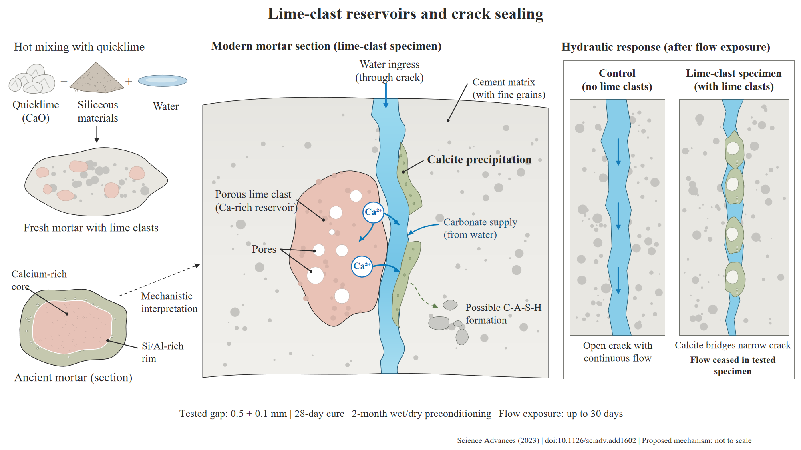

[Editable PPT](../examples/cases/12-self-healing-concrete.pptx) · [Scene file](../examples/cases/12-self-healing-concrete.json)

Source: [Hot mixing: Mechanistic insights into the durability of ancient Roman concrete](https://doi.org/10.1126/sciadv.add1602), *Science Advances* (2023). Independently composed from the reported concepts; no published figure is reproduced.

